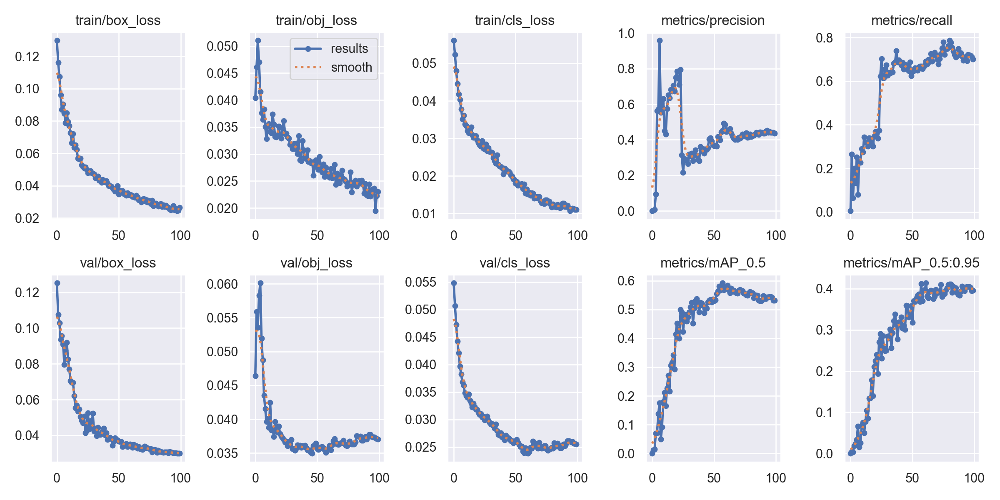

# 草莓成熟度识别系统 · YOLOv5

基于 YOLOv5s 的草莓目标检测项目，识别画面中的草莓位置和六个成熟阶段。支持图片、文件夹、视频、本机摄像头以及 RTSP 视频流，并提供训练和验证入口。

现有权重已训练 100 轮。本仓库整理了原始项目的运行方式、配置、训练记录与中文文档，适合继续实验和演示。

## 类别

| ID | 模型类别 | 中文解释 |
|---|---|---|
| 0 | Early-Turning | 早期转色 |
| 1 | Green | 青果 |
| 2 | Late-Turning | 后期转色 |
| 3 | Red | 红熟 |
| 4 | Turning | 转色 |
| 5 | White | 白果 |

类别顺序与实际模型一致。中文解释仅用于理解，标注阶段边界需结合原数据集标准确认。

## 安装

推荐 Python 3.10。以下是 Windows PowerShell 命令，Linux/macOS 激活环境时使用 `source .venv/bin/activate`。

```powershell
git clone https://github.com/XhyLee/strawberry-ripeness-yolov5.git
cd strawberry-ripeness-yolov5
python -m venv .venv
.\.venv\Scripts\Activate.ps1
python -m pip install --upgrade pip

# CPU 环境；NVIDIA 用户可按 PyTorch 官方说明选择匹配的 CUDA 版本
python -m pip install torch==2.4.1 torchvision==0.19.1 --index-url https://download.pytorch.org/whl/cpu
python -m pip install -r requirements.txt

# 下载项目的草莓模型，自动校验 SHA-256
python strawberry.py download-weights
```

若 PowerShell 限制脚本激活，可直接使用 `.\.venv\Scripts\python.exe` 替代后续命令中的 `python`。已提供的本地项目保留原虚拟环境，通常无需重新创建。

模型位于 [v1.0.1 Release](https://github.com/XhyLee/strawberry-ripeness-yolov5/releases/tag/v1.0.1)，没有放进 Git 历史。也可以手动下载 `strawberry_best.pt` 到 `weights/`，对照 `weights/SHA256SUMS.txt` 校验。检查点使用 PyTorch 加载机制，只加载可信来源模型。

## 快速检测

```powershell
# 单张图片，保存检测框和类别置信度
python strawberry.py detect --source "D:/photos/strawberry.jpg" --save-txt --save-csv

# 文件夹或本地视频
python strawberry.py detect --source "D:/photos/strawberries"
python strawberry.py detect --source "D:/videos/strawberry.mp4"

# 本机摄像头，--view 打开实时画面
python strawberry.py cameras
python strawberry.py detect --source 0 --view

# Milk-V 或其他相机提供的 RTSP 流；替换为实际设备地址
python strawberry.py detect --source "rtsp://CAMERA_IP:8554/stream0" --view --no-save

# NVIDIA CUDA：使用显卡 0
python strawberry.py detect --source "D:/photos/strawberry.jpg" --device 0
```

默认在 CPU 上运行，输入尺寸 640，置信度阈值 0.5，IoU 阈值 0.45。可通过 `--conf`、`--iou`、`--imgsz`、`--weights` 调整。

检测输出保存到 `runs/detect/strawberry*`，重复运行会自动增加编号。`--save-txt` 保存归一化框坐标和置信度；`--save-csv` 保存每个检测对象的图片名、类别和置信度。未检测到目标时可能没有标签或 CSV 文件。`--no-save` 关闭图片/视频保存，适合持续视频流；标签和 CSV 按各自开关控制。

关闭实时画面可按 `q`，终端运行可用 `Ctrl+C`。RTSP 流需要电脑与设备网络互通，推理发生在运行命令的电脑上。

查看参数和模型信息：

```powershell
python strawberry.py --help
python strawberry.py detect --help
python strawberry.py info
```

## 训练与验证

原训练数据的外部目录目前不存在，项目内的 `datasets/coco128` 只是 COCO 示例数据。草莓数据集不包含在 Git 仓库中；请先按 [数据集说明](docs/DATASET.md) 准备照片和 YOLO 标注，修改 `configs/strawberry.yaml`。

```powershell
# 从发布的草莓权重进行新的微调实验
python strawberry.py train --epochs 100 --batch-size 8 --device cpu

# 使用训练结果重新验证
python strawberry.py validate --weights runs/train/strawberry/weights/best.pt
```

Windows 默认 `--workers 0`。显存或内存不足时降低 `--batch-size`。原来的 DirectML 探测脚本仅测试过矩阵计算，并未接入 YOLOv5 训练流程，因此此入口提供 CPU/CUDA 设备参数，不宣称支持 AMD DirectML 训练。

## 已有训练记录

原实验为 YOLOv5s、100 轮、640 输入、batch size 16。历史验证日志中综合 fitness 最高一轮（epoch 61）的记录为：

| Precision | Recall | mAP@0.5 | mAP@0.5:0.95 |
|---:|---:|---:|---:|
| 0.44825 | 0.69143 | 0.58318 | 0.41388 |

这些是原训练过程中的验证指标，不能直接当作新场景的识别准确率。未重新训练，缺少原数据时也无法重新复现验证。详见 [模型说明](docs/MODEL_CARD.md)。



## 目录

```text
strawberry.py            统一命令行入口
configs/strawberry.yaml  六类别数据集配置
weights/                模型元数据、校验值；下载后的模型不提交 Git
reports/training/       原始指标 CSV、训练曲线、混淆矩阵
docs/                   数据集说明与模型说明
tests/                  配置、类别顺序与下载校验测试
yolov5-master/          保留的 YOLOv5 源码与许可证
datasets/               本地数据，不上传
runs/                   检测、训练与验证输出，不上传
```

原 `yolov5-master/milkv_detect.py` 与 `find_camera.py` 保留为兼容入口，分别转发到 `detect`、`cameras`；前者现在必须显式指定 `--source`。上游分类、分割等模块作为源码依赖保留，不表示本项目已训练对应模型。

## 常见问题

- **找不到权重**：运行 `python strawberry.py download-weights`；已有模型可使用 `--weights` 指定。
- **下载失败**：通过 Release 页面手动下载，或检查 GitHub 网络访问。
- **摄像头打不开**：先执行 `cameras`，检查权限、索引及其他软件是否占用相机。
- **RTSP 无画面或中断**：先确认视频地址和网络，再使用媒体播放器检查设备是否正常推流。
- **类别不匹配**：必须采用上表中的 0–5 类别顺序；程序会拒绝顺序不一致的数据配置。
- **Linux 无显示环境**：省略 `--view`；OpenCV 如缺少 `libGL.so.1`，安装系统的 `libgl1` 和 `libglib2.0-0`。

## 检查与许可

```powershell
python -m unittest discover -s tests -v
```

程序入口、配置检查和本地图片推理已在 Windows/Python 3.10/PyTorch 2.4.1 CPU 环境验证。摄像头、RTSP、CUDA 及完整重训仍需对应硬件与数据验证。

本项目包含 Ultralytics YOLOv5，遵循 [AGPL-3.0](LICENSE)。来源与修改范围见 [第三方说明](THIRD_PARTY_NOTICES.md)。
