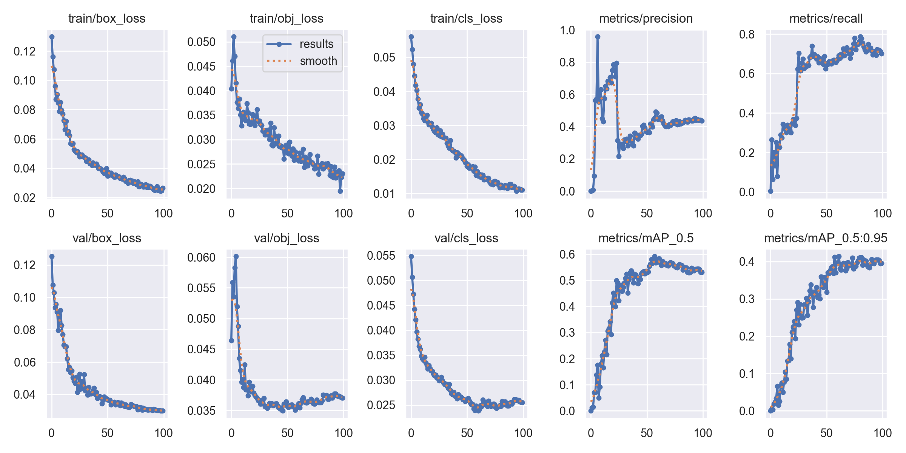
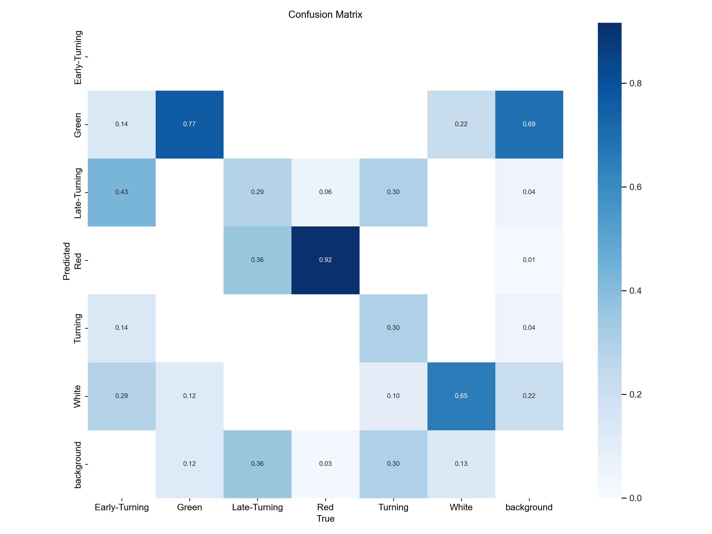

# 模型说明

## 来源和任务

- 任务：草莓目标检测与六阶段成熟度分类。
- 基础网络：YOLOv5s，使用项目内保留的 YOLOv5 源码。
- 发布权重：原本地 `yolov5-master/runs/train/exp3/weights/best.pt`，约 14.4 MB。
- 权重类别顺序由实际检查点读取，参见 `weights/model.json`。
- 原训练配置：100 轮，图像尺寸 640，batch size 16，SGD，seed 0。
- 原数据集目录已失效，来源、授权情况、样本数量和划分比例无法从当前项目确认，因此未重新发布数据集。

## 已记录的训练指标

下表来自保留的 `reports/training/results.csv`，epoch 为日志的从 0 开始编号。它们是原训练过程中的验证记录，未在新的独立测试集上重新测量。

| 日志位置 | Precision | Recall | mAP@0.5 | mAP@0.5:0.95 |
|---|---:|---:|---:|---:|
| 综合 fitness 最高，epoch 61（第 62 轮） | 0.44825 | 0.69143 | 0.58318 | 0.41388 |
| 最后一轮，epoch 99（第 100 轮） | 0.43577 | 0.70020 | 0.53133 | 0.39630 |

YOLOv5 的上述 fitness 为 `0.1 × mAP@0.5 + 0.9 × mAP@0.5:0.95`。发布权重已去除训练优化器且 checkpoint epoch 为 -1，不能单凭该字段证明其对应日志中的具体轮次。表格用于说明日志表现，不构成对任意场景准确率的保证。

## 使用边界与改进方向

相邻转色阶段可能混淆，遮挡和复杂光照会影响判断。默认检测阈值为 0.5，可根据验证集调整；提高阈值通常会减少输出，同时可能增加漏检。当前项目没有糖度检测、产量估算或自动采摘控制功能。

后续重点是恢复原始数据与标注标准、补充少数类别、建立独立测试集，再比较各阶段召回率。此版本整理运行入口与文档，未重新训练或宣称提升模型指标。

RTSP 模式由电脑运行 PyTorch 推理并读取相机视频流；它不代表模型已部署在 Milk-V 板端。摄像头及 RTSP 需要实机验证。

## 文件与软件许可

YOLOv5 源码保留原作者信息与 AGPL-3.0 许可证，项目代码按根目录 `LICENSE` 使用。参见 `THIRD_PARTY_NOTICES.md`。权重公开发布不替代对训练数据授权的核实。
